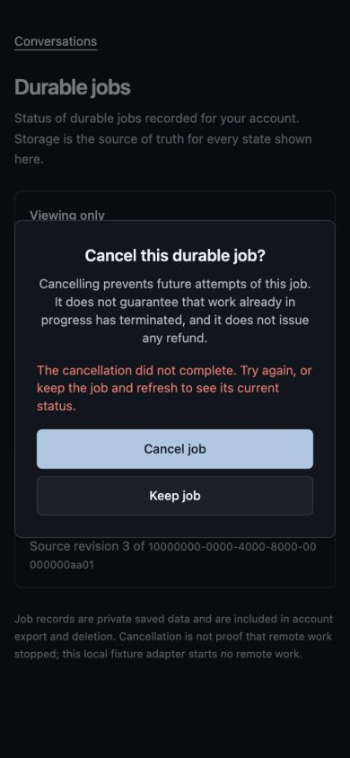
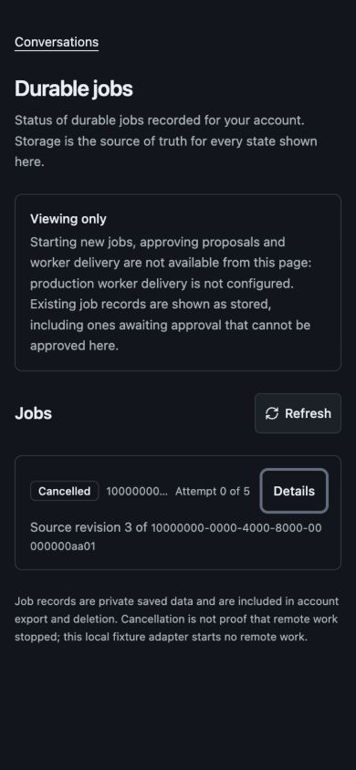

# Jobs status review — October 24, 2026

Reviewed Zcode head `6a849a5`, then root correction `5ba54d9` integrated with main `3f1a9d0` by a normal merge. No worker activation or real remote job execution.

## Correctness

The six original findings are addressed: source identity has no misleading pinned download; cancellation awaits a fresh list; stale reads cannot restore active state; reads have timeouts and lifecycle cancellation; cancellation failures remain announced inside the dialog; focus returns to its opener or stable row fallback.

Root reproduced and fixed four additional lifecycle regressions: pre-aborted cancellation dispatched a fetch, settled requests retained an external abort listener, React Strict Mode replay left initial loading stuck, and returning from a hidden tab did not restart its aborted initial load. New behavior tests cover all four. Focused client/UI/owned HTTP tests: 21 pass, 127 assertions, 6.89 seconds before main integration. Final integrated results are recorded in the PR.

## Fresh browser evidence

Actual JobsWorkbench and installed Radix components were rendered with the real compiled application stylesheet in a loopback-only fixture. Its client used synthetic in-memory records and one deliberate cancellation failure; this proves UI behavior, not production authentication, database execution or remote termination. Owned HTTP behavior is checked separately by integration tests.

Native Tab reached Conversations → Refresh → Details → Cancel. Enter opened the dialog, whose initial focus was Keep job. Escape and Keep restored Cancel focus. Tab then Enter confirmed cancellation; the cancelled row lost its Cancel button and focus moved to Details. On failure, the dialog retained its visible error and retry controls; Enter retried successfully and restored Details focus. These were browser key events, not component-test substitutes.

Fresh captures inspected 390×844 and 1280×900, light and dark. Source identifiers wrapped within the row. Mobile error and success evidence:

No remaining blocking finding in this scoped review. Reduced-motion selectors were source-inspected; this pass did not emulate the operating system motion preference or measure Event Timing latency. Screen-reader speech and real mobile hardware were not exercised. The standalone fixture omits the full application shell; it is not a production route screenshot.
